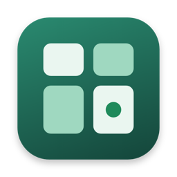

<p align="center"></p>

<h1 align="center">PlanAIBoard</h1>

<p align="center">
  <b>One local dashboard for all the AI assistants on your Mac.</b><br>
  <sub>macOS only · Python 3 · no dependencies · MIT</sub>
</p>

> **Nothing leaves your computer unless you ask your own AI for help, and you approve every change.**

If you use more than one AI tool (Claude Code, Codex, Gemini CLI, Cursor, Copilot CLI, OpenCode…), your setup quickly turns into a pile of hidden config folders and files you can't see at a glance. PlanAIBoard scans your Mac, **shows you what is installed**, lets you **choose which folders each tool may read**, and lets you **hook them together** — all from a simple page in your browser.

## What it does

- 🔍 **Finds your AI tools.** Detects Claude Code, OpenCode, Codex, Gemini CLI, Cursor and GitHub Copilot CLI (you can add your own).
- 🗂️ **Shows what it found.** Programs, config folders, and features available on this Mac. Only what really exists is displayed.
- 🔗 **Links tools to your folders.** You pick the folders that may be read. Everything else stays untouched.
- 🚫 **"Never read" list.** `.env`, `*.pem`, `*.key`, `.ssh`, `.aws`, `.gnupg`, browser profiles, Mail, Messages… are excluded by default. You can edit the list.
- ↩️ **Safe by design.** Hooking a tool adds one marked block to its instructions file, after making a `.bak` backup. One click undoes it.
- 🤖 **Optional setup assistant.** Ask a *local* AI (Ollama, LM Studio) or an installed one (Claude Code, Codex) to suggest a setup. It only sees names, never file contents, and only after your consent. You approve every proposal.
- 🎨 **Make it yours.** Light/dark theme, accent color, title.
- 🌍 **Multilingual.** English, Italian, German, Spanish, French. Add a language by dropping a `lingue/xx.json` file.

## Install

You need a Mac with **Python 3**. Check in Terminal:

```bash
python3 --version
```

If it's missing, install it from [python.org](https://www.python.org/downloads/macos/).

**Option A: with git**

```bash
git clone https://github.com/Mkseev/PlanAIBoard.git
cd PlanAIBoard
./avvia.command
```

**Option B: no git**

1. Click **Code → Download ZIP** at the top of this page and unzip it.
2. Double-click **`avvia.command`**.
3. The first time, macOS may block it: right-click the file → **Open** → **Open**.

Your browser opens on `http://127.0.0.1:20150`. Follow the short tour and you're done.

> To use another port: `PORTA_SISTEMA=20200 python3 sistema.py`

## Privacy

- The server listens **only on `127.0.0.1`** (your own computer). No account, no cloud, no telemetry.
- The scan checks only **whether files and folders exist**, never what is inside them.
- With the optional assistant, a **summary of names** (never file contents) goes to the AI *you* choose, after your consent.
- Your choices live in `impostazioni.json`. You can edit it by hand.

## Uninstall

Use the undo option in the page to remove the blocks added to your tools, then delete the folder. That's all: nothing is installed elsewhere.

## Disclaimer

Not affiliated with Anthropic, OpenAI, Google, GitHub, Cursor or any other vendor mentioned. Their names are trademarks of their owners and are used only to recognise installed programs.

## License

[MIT](LICENSE)

---

<details>
<summary><b>🇮🇹 Italiano</b></summary>

**Solo macOS.** Una dashboard locale per i tuoi assistenti AI su Mac. Trova i programmi AI installati, mostra tutto quello che ha trovato, li collega alle tue cartelle e ti lascia scegliere cosa usare. Gira solo sul tuo computer.

**Avvio:** serve Python 3 (da [python.org](https://www.python.org/downloads/macos/) se manca). Scarica lo ZIP con **Code → Download ZIP**, decomprimilo e fai doppio clic su `avvia.command`. La prima volta macOS potrebbe bloccarlo: clic destro → Apri → Apri. Si apre la pagina su `http://127.0.0.1:20150`: segui il tour.

**Privacy:** niente esce dal tuo computer. Solo se usi l'assistente facoltativo, un riassunto di nomi (mai contenuti di file) va alla IA che scegli, dopo il tuo consenso. L'aggancio ai programmi crea sempre una copia di sicurezza (`.bak`) e si può annullare.

</details>
